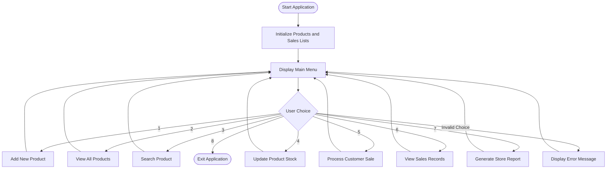

# 🛒 Smart Grocery Store Management System

A beginner-friendly Python console application designed to simplify grocery store management by maintaining product inventory, managing stock quantities, processing customer sales, recording transactions, and generating store reports.

---

## 📌 Project Overview

The **Smart Grocery Store Management System** is a menu-driven Python application developed to simulate the basic operations of a local grocery store.

The system allows store owners to manage products, monitor available stock, search product information, process customer purchases, maintain sales records, and generate useful inventory and sales reports.

This project demonstrates fundamental Python programming concepts through a practical real-world scenario.

---

## 🎯 Project Objectives

- Maintain organized product records.
- Simplify product inventory management.
- Prevent duplicate product IDs.
- Manage stock quantities efficiently.
- Process customer sales accurately.
- Maintain transaction records.
- Calculate total sales revenue.
- Identify low-stock products.
- Generate meaningful store reports.
- Apply Python programming concepts to a real-world problem.

---

## 🛠️ Technologies Used

| Technology | Purpose |
|---|---|
| Python 3 | Application development |
| Lists | Store multiple product and sales records |
| Dictionaries | Represent individual products and transactions |
| Functions | Organize application operations |
| Loops | Process records and maintain the application menu |
| Conditional Statements | Handle operations and validation |
| Exception Handling | Handle invalid numeric inputs |
| VS Code | Development environment |
| Git & GitHub | Version control and project hosting |

---

## 📋 Assignment Requirements & Implementation

### 1. Product Management

The system stores multiple products using a list of dictionaries.

Each product contains:

- Product ID
- Product Name
- Category
- Price
- Available Stock

**Example Product Record:**

```python
products = [
    {
        "id": 101,
        "name": "Milk",
        "category": "Dairy",
        "price": 250,
        "stock": 20
    }
]
```

Each dictionary represents an individual product, while the list maintains all product records.

---

### 2. Add New Products

The application allows users to add new products by entering:

- Product ID
- Product Name
- Product Category
- Product Price
- Available Stock

The entered information is stored in a dictionary and added to the products list using `.append()`.

**Features:**

- Prevents duplicate product IDs.
- Validates product information.
- Rejects empty product names and categories.
- Prevents negative prices and stock quantities.
- Handles invalid numeric inputs.

**Example Output:**

```text
====================================
          ADD NEW PRODUCT
====================================

Enter Product ID: 105
Enter Product Name: Eggs
Enter Product Category: Dairy
Enter Product Price: 300
Enter Available Stock: 25

Product added successfully!

Product ID: 105
Product Name: Eggs
Category: Dairy
Price: Rs. 300.0
Available Stock: 25
```

---

### 3. Display All Products

The system displays all available products in a readable format.

Product information includes:

- Product ID
- Product Name
- Category
- Price
- Available Stock

A `for` loop is used to process and display each product dictionary.

**Example Output:**

```text
====================================
          ALL PRODUCTS
====================================

------------------------------------
Product ID: 101
Product Name: Milk
Category: Dairy
Price: Rs. 250
Available Stock: 20
------------------------------------

Product ID: 102
Product Name: Bread
Category: Bakery
Price: Rs. 150
Available Stock: 15
------------------------------------

Product ID: 103
Product Name: Rice
Category: Grains
Price: Rs. 300
Available Stock: 10
------------------------------------
```

---

### 4. Search Products

Users can search for products using either:

- Product ID
- Product Name

The system displays complete product information when a matching product is found.

If the product does not exist, an appropriate message is displayed.

**Example Output:**

```text
====================================
          SEARCH PRODUCT
====================================

Enter Product Name or ID: Milk

Product Found!

------------------------------------
Product ID: 101
Product Name: Milk
Category: Dairy
Price: Rs. 250
Available Stock: 20
------------------------------------
```

**Search Failure:**

```text
Enter Product Name or ID: Juice

Product with this name does not exist!
```

---

### 5. Update Product Stock

The application allows users to update stock quantities using a product ID.

Two stock management operations are available:

**Add Stock**
- Adds a new quantity to existing stock.
- Useful when new inventory arrives.

**Set Stock Quantity**
- Replaces the existing stock quantity.
- Useful when correcting inventory records.

**Example Output:**

```text
====================================
        UPDATE PRODUCT STOCK
====================================

Enter Product ID: 101

Product Name: Milk
Current Stock: 20

1. Add Stock
2. Set Stock Quantity

Enter your choice: 1
Enter quantity to add: 10

Stock added successfully!

------------------------------------
Product Name: Milk
Product ID: 101
Updated Stock: 30
------------------------------------
```

---

### 6. Process a Customer Sale

The system processes customer purchases by collecting:

- Product ID
- Purchase Quantity

Before completing a sale, the application verifies:

1. The product exists.
2. The purchase quantity is greater than zero.
3. Sufficient stock is available.

The system then:

- Calculates the total purchase amount.
- Deducts the purchased quantity from available stock.
- Creates a sales record.
- Displays a purchase summary.

**Calculation:**

`Total Amount = Product Price × Purchase Quantity`

**Example Output:**

```text
====================================
        PROCESS CUSTOMER SALE
====================================

Enter Product ID: 101

Product Name: Milk
Price: Rs. 250
Available Stock: 20

Enter Purchase Quantity: 2

====================================
        PURCHASE SUMMARY
====================================

Product ID: 101
Product Name: Milk
Price per Unit: Rs. 250
Quantity Purchased: 2
Total Amount: Rs. 500
Remaining Stock: 18

====================================
Sale completed successfully!
```

**Stock Validation:**

```text
Enter Purchase Quantity: 25

Insufficient stock!
Available Stock: 20
Requested Quantity: 25
```

The sale is rejected when the requested quantity exceeds available stock.

---

### 7. Store Sales Records

The system maintains a separate sales list containing dictionaries for completed transactions.

Each sales record contains:

- Product ID
- Product Name
- Quantity Sold
- Total Amount

Sales records are added using `.append()` after successful transactions.

**Example Sales Record:**

```python
sales = [
    {
        "product_id": 101,
        "product_name": "Milk",
        "quantity": 2,
        "total_amount": 500
    }
]
```

**Example Output:**

```text
====================================
          SALES RECORDS
====================================

------------------------------------
Product ID: 101
Product Name: Milk
Quantity Sold: 2
Total Amount: Rs. 500
------------------------------------
```

---

### 8. Generate Store Report

The application generates a store report containing inventory and sales information.

**Report Includes:**

| Report Information | Description |
|---|---|
| Total Products | Number of product records |
| Total Available Stock | Sum of stock quantities |
| Total Sales Transactions | Number of completed sales |
| Total Revenue | Revenue from completed transactions |
| Low Stock Products | Products with stock below 5 units |
| Highest Price Product | Product with maximum price |
| Lowest Price Product | Product with minimum price |

**Example Output:**

```text
====================================
          STORE REPORT
====================================

Total Number of Products: 4
Total Available Stock: 48
Total Sales Transactions: 2
Total Revenue Generated: Rs. 1000

------------------------------------
       LOW STOCK PRODUCTS
------------------------------------

Sugar - Stock: 3 - ID: 104

------------------------------------
       HIGHEST PRICE PRODUCT
------------------------------------

Product Name: Rice
Product ID: 103
Price: Rs. 300

------------------------------------
       LOWEST PRICE PRODUCT
------------------------------------

Product Name: Bread
Product ID: 102
Price: Rs. 150

====================================
       END OF STORE REPORT
====================================
```

*Sample values are illustrative and depend on the products and transactions entered during execution.*

---

## 🔄 Application Workflow

The system follows a simple menu-driven workflow.



---

## 🖥️ Application Menu

```text
====================================
SMART GROCERY STORE SYSTEM
====================================

1. Add New Product
2. View All Products
3. Search Product
4. Update Product Stock
5. Process Customer Sale
6. View Sales Records
7. Generate Store Report
8. Exit

Enter your choice:
```

The application continues running until the user selects option `8`.

---

## 🧪 Test Cases

The following test cases verify the major functionalities and validation rules of the application.

| TC ID | Test Scenario | Test Input | Expected Result |
|---|---|---|---|
| TC-01 | Add a valid product | ID: 105, Eggs | Product added successfully |
| TC-02 | Add duplicate product ID | ID: 101 | Duplicate ID rejected |
| TC-03 | Enter negative product price | Price: -100 | Invalid price rejected |
| TC-04 | Enter negative stock | Stock: -5 | Invalid stock rejected |
| TC-05 | Enter non-numeric product ID | ID: ABC | Error message displayed |
| TC-06 | View all products | Menu: 2 | All products displayed |
| TC-07 | Search existing product by ID | ID: 101 | Product details displayed |
| TC-08 | Search existing product by name | Milk | Product details displayed |
| TC-09 | Search nonexistent product | Juice | Product not found message |
| TC-10 | Add stock | ID: 101, Add: 10 | Stock increases by 10 |
| TC-11 | Set stock quantity | ID: 101, New: 50 | Stock becomes 50 |
| TC-12 | Set negative stock | ID: 101, New: -5 | Invalid stock rejected |
| TC-13 | Process valid sale | ID: 101, Qty: 2 | Sale completed and stock deducted |
| TC-14 | Process sale with insufficient stock | ID: 101, Qty: 100 | Sale rejected |
| TC-15 | Process sale with invalid quantity | Qty: -2 | Sale rejected |
| TC-16 | Process sale with nonexistent ID | ID: 999 | Product not found |
| TC-17 | View sales records | Menu: 6 | Completed sales displayed |
| TC-18 | Generate store report | Menu: 7 | Complete report displayed |
| TC-19 | Check low stock products | Stock: 3 | Product included in low-stock report |
| TC-20 | Exit application | Menu: 8 | Application terminates |

### Test Case: Successful Customer Sale

**Initial Product Record:**

```python
{
    "id": 101,
    "name": "Milk",
    "category": "Dairy",
    "price": 250,
    "stock": 20
}
```

**Test Input:**

```text
Product ID: 101
Purchase Quantity: 2
```

**Expected Results:**

```text
Total Amount: Rs. 500
Remaining Stock: 18
Sales Transactions: 1
Total Revenue: Rs. 500
```

---

## 📂 Project Structure

```text
smart-grocery-store/
│
├── grocery_store.py
│
└── README.md
```

| File | Description |
|---|---|
| `grocery_store.py` | Main Python application |
| `README.md` | Project documentation |

---

## ⚙️ Installation & Execution

### Prerequisites

- Python 3 installed
- Visual Studio Code or any Python-supported editor

### Step 1: Clone the Repository

```bash
git clone <your-repository-url>
```

### Step 2: Navigate to the Project Directory

```bash
cd smart-grocery-store
```

### Step 3: Run the Application

```bash
python grocery_store.py
```

The application will display the main menu and allow the user to perform grocery store operations.

---

## 🧠 Python Concepts Demonstrated

This project demonstrates practical use of the following Python concepts:

- Variables and data types
- Lists and dictionaries
- Dictionary keys and values
- List `.append()` method
- User input using `input()`
- Type conversion using `int()` and `float()`
- Conditional statements (`if`, `elif`, `else`)
- `for` loops
- `while` loops
- Functions and return values
- Dictionary updates
- Arithmetic operations
- Accumulators
- List searching
- Minimum and maximum comparisons
- Input validation
- Exception handling using `try` and `except`
- Boolean flags
- List length using `len()`

---

## ⚠️ Limitations

- Product and sales records are stored in memory.
- Data is not permanently saved after the program terminates.
- The application does not use a database.
- The system does not include a graphical user interface.
- Sales records do not include dates, customer information, or invoice numbers.
- The system is designed for basic inventory and sales management.

---

## 🚀 Future Improvements

Potential enhancements for future versions include:

- Persistent storage using JSON or CSV files.
- Database integration using MySQL or SQLite.
- Product deletion functionality.
- Product price update functionality.
- Sales invoices and receipts.
- Sales history with dates and timestamps.
- Customer management.
- Daily and monthly sales reports.
- Graphical user interface.
- Automatic low-stock alerts.

---

## 👩‍💻 Developer

**Developed by:** Syyeda Maheen Bukhari

**Project:** Smart Grocery Store Management System

**Language:** Python

**Purpose:** Python programming practice and assignment implementation.

---

## 📄 License

This project was developed for educational purposes and Python programming practice.
