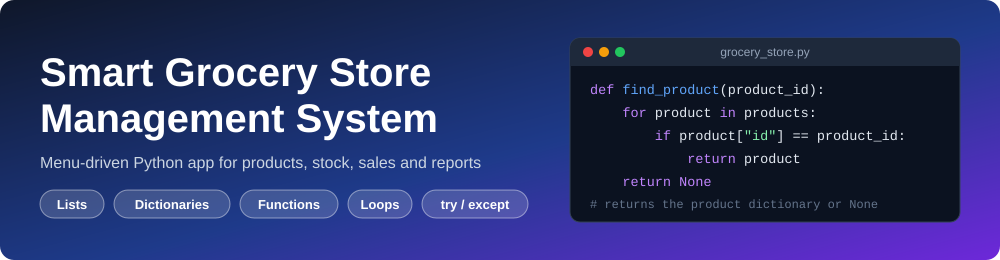
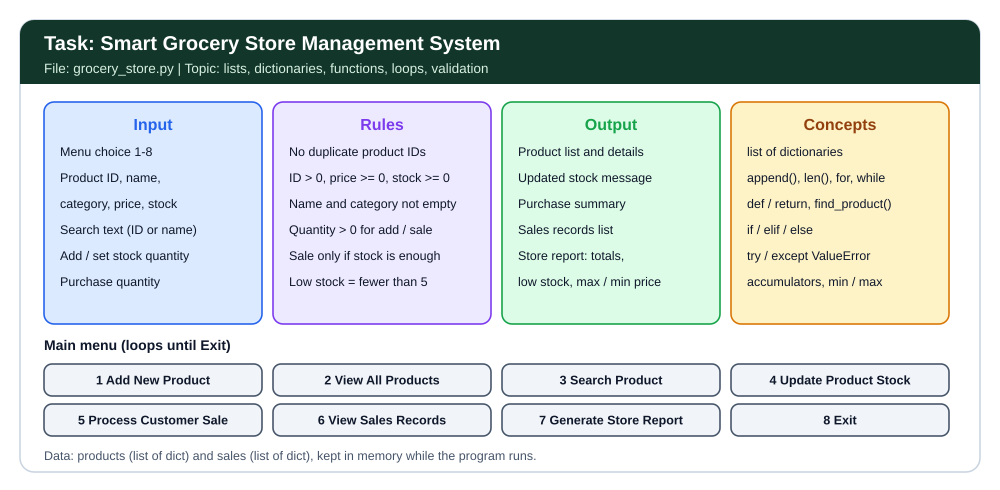
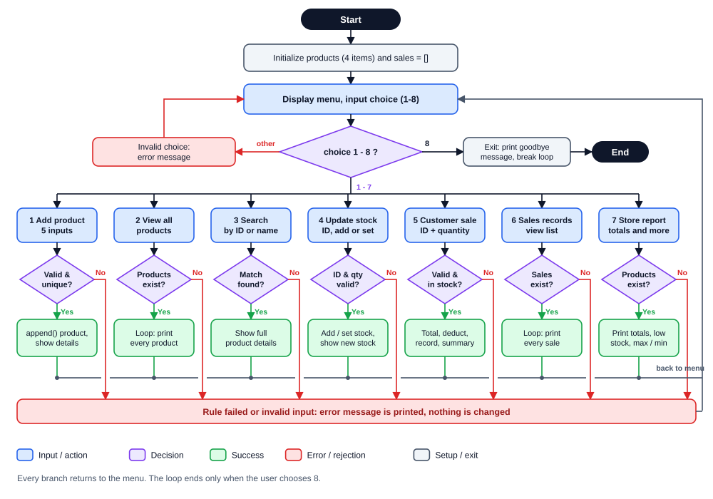
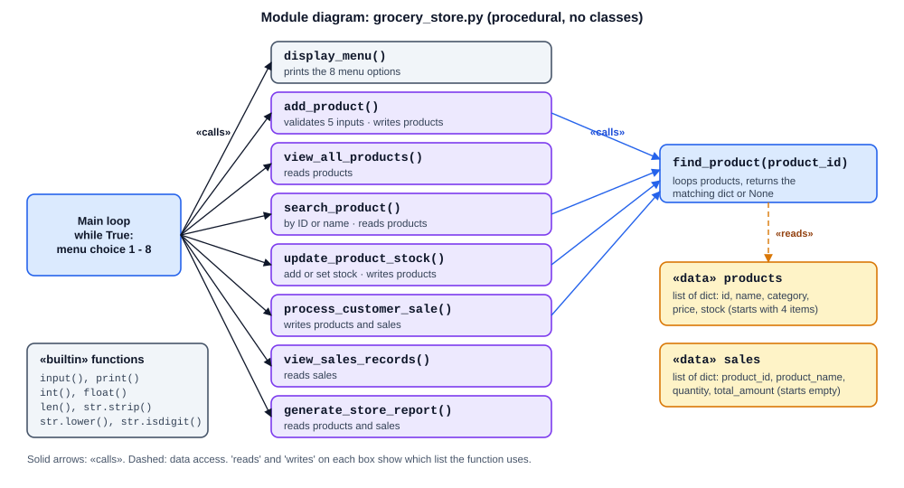

<p align="center"></p>

## 1. Project Overview

> **Live demo (no install needed):** [https://syedamaheen05.github.io/smart-grocery-store-management-system/](https://syedamaheen05.github.io/smart-grocery-store-management-system/)
> Use the project in your browser with buttons and forms. The page prints the same messages as the Python program. See [How to Run](#6-how-to-run) for how the demo is hosted.

A menu-driven Python console application that manages a small grocery store: products, stock, customer sales, sales records and a store report.

| Task | File | Topic |
|---|---|---|
| Smart Grocery Store Management System | `grocery_store.py` | Lists, dictionaries, functions, loops, conditions, input validation |
| Live demo (browser version) | `index.html` | Same operations and messages with a form-based interface |



## 2. Folder Structure

```text
smart-grocery-store-management-system/
├── grocery_store.py
├── index.html
├── README.md
└── assets/
    ├── banner.svg
    ├── overview.svg
    ├── grocery_flow.svg
    └── uml_diagram.svg
```

## 3. Task: Smart Grocery Store Management System

### Summary

`grocery_store.py` keeps products in a list of dictionaries (`products`) and completed sales in a second list of dictionaries (`sales`). A `while True` loop shows the menu until the user chooses `8`. Each menu option calls its own function, and `find_product()` is shared by the functions that look a product up by ID. Starting data: Milk (101), Bread (102), Rice (103) and Sugar (104).

### Rules

| # | Requirement from the brief | Where it is implemented |
|---|---|---|
| 1 | Store products as a list of dictionaries (id, name, category, price, stock) | `products` list at the top of the file |
| 2 | Add products, store each as a dictionary, use `.append()`, block duplicate IDs | `add_product()` with `find_product()` |
| 3 | Display all products in a readable format | `view_all_products()` |
| 4 | Search by name or ID, message if not found | `search_product()` |
| 5 | Ask for an ID, add stock or set quantity, show updated stock | `update_product_stock()` |
| 6 | Sale: product exists, enough stock, total price, deduct stock, summary, reject if quantity exceeds stock | `process_customer_sale()` |
| 7 | Separate list of dictionaries for sales (product ID, name, quantity, total) | `sales` list, `view_sales_records()` |
| 8 | Report: product count, total stock, transactions, revenue, stock below 5, highest and lowest price | `generate_store_report()` |
| - | Menu runs until Exit; at least two custom functions; loops, dictionary keys, conditions, validation, comments | `display_menu()` and the main `while True` loop; 9 functions in total |

### Program Flow



### Code Methods Description

| Method or section | Purpose |
|---|---|
| `products` | List of product dictionaries (`id`, `name`, `category`, `price`, `stock`) |
| `sales` | List of sale dictionaries (`product_id`, `product_name`, `quantity`, `total_amount`) |
| `display_menu()` | Prints the 8 menu options |
| `find_product(product_id)` | Loops through `products`; returns the matching dictionary or `None` |
| `add_product()` | Reads and validates 5 inputs, rejects duplicate IDs, appends the new dictionary |
| `view_all_products()` | Prints every product with a `for` loop |
| `search_product()` | Digits are searched as an ID; any other text is matched to a name (not case sensitive) |
| `update_product_stock()` | Finds the product, then adds to stock (choice 1) or replaces stock (choice 2) |
| `process_customer_sale()` | Checks product and quantity, calculates total, deducts stock, appends a sale, prints the summary |
| `view_sales_records()` | Prints every sale with a `for` loop |
| `generate_store_report()` | Uses accumulators, a low-stock list, and max / min price comparisons |
| Main `while True` loop | Shows the menu, reads the choice, calls the matching function, stops on `8` |

### Input Validation

| Input | Rule | Message shown |
|---|---|---|
| Product ID (add, update, sale) | Whole number | `Invalid Product ID! Enter a numeric value.` |
| Product ID | Greater than zero | `Product ID must be greater than zero!` |
| Product ID (add) | Not already used | `Product ID already exists! Try another ID.` |
| Product ID (update, sale) | Must exist | `Product does not exist!` |
| Name, category | Not empty after trimming spaces | `Product name cannot be empty!` / `Product category cannot be empty!` |
| Price | Number, not negative | `Invalid price! Enter a numeric value.` / `Price cannot be negative!` |
| Stock (add) | Whole number, not negative | `Invalid stock! Enter a whole number.` / `Stock cannot be negative!` |
| Add-stock quantity | Whole number, greater than zero | `Invalid quantity! Enter a whole number.` / `Quantity must be greater than zero!` |
| Set-stock quantity | Whole number, not negative | `Invalid quantity! Enter a whole number.` / `Stock cannot be negative!` |
| Stock update choice | `1` or `2` | `Invalid stock update choice!` |
| Purchase quantity | Whole number, greater than zero, not above stock | `Invalid quantity! Enter a whole number.` / `Purchase quantity must be greater than zero!` / `Insufficient stock!` |
| Search value | Not empty | `Search value cannot be empty!` |
| Menu choice | `1` to `8` | `Invalid choice! Please select from 1 to 8.` |

**Known behavior (found while testing):** Python's `float()` accepts the words `nan` and `inf`, and `nan < 0` is false, so a price of `nan` is accepted by the console program (test 38). A `nan` price is then skipped when the report looks for the highest and lowest price. Prices such as `300` are stored as floats, so they print as `300.0` for products added at run time, while the four starting products keep whole-number prices. The browser demo (`index.html`) rejects `nan` and `inf` as invalid prices.

### Expected Results

- Starting menu shows 4 products with total stock 48; only Sugar (stock 3) is low stock.
- A valid sale lowers stock by the quantity sold, adds one sales record, and adds the total to revenue (Milk x2 gives Rs. 500 and stock 18).
- A failed check prints one message, changes nothing, and returns to the menu.
- The report always shows: product count, total stock, transactions, revenue, low-stock list (below 5), highest-priced and lowest-priced product.
- Data is kept in memory only, so it resets every time the program starts.

## 4. UML Diagram

I chose a **module diagram** because the code is procedural (one file, global lists, functions and no classes), so it shows what calls what and which list each function uses.



## 5. Concepts and Techniques Used

- Lists of dictionaries for products and sales
- Dictionary keys and values (`product["stock"]`)
- `.append()`, `len()`, `.strip()`, `.lower()`, `.isdigit()`
- Functions with `return` (`find_product()` returns a dictionary or `None`)
- `for` loops to search, display and total records
- `while True` menu loop with `break`
- `if` / `elif` / `else` for menu routing and rules
- `try` / `except ValueError` with `int()` and `float()`
- Accumulators for stock and revenue
- Maximum and minimum price comparison
- Boolean flag (`product_found`)

## 6. How to Run

**Requirements:** Python 3 (tested with Python 3.12.3). No extra libraries.

```bash
git clone https://github.com/Syedamaheen05/smart-grocery-store-management-system.git
cd smart-grocery-store-management-system
```

Run the console program with whichever command works on your computer:

```bash
python grocery_store.py      # most systems
python3 grocery_store.py     # Linux / macOS
py grocery_store.py          # Windows launcher
```

**Run the live demo:** open [https://syedamaheen05.github.io/smart-grocery-store-management-system/](https://syedamaheen05.github.io/smart-grocery-store-management-system/), or open `index.html` from the downloaded folder in any browser.

**Host the demo on GitHub Pages:** repository **Settings > Pages > Build and deployment > Deploy from a branch > `main` / `(root)` > Save**. After a minute the demo is live at the link above.

## 7. Sample Execution

All outputs below were captured from real runs of `grocery_store.py`. Typed input appears after each prompt. The repeated menu is left out to keep it short.

**Add a product (success)**

```text
Enter your choice: 1
====================================
          ADD NEW PRODUCT
====================================
Enter Product ID: 105
Enter Product Name: Eggs
Enter Product Category: Dairy
Enter Product Price: 300
Enter Available Stock: 25

Product added successfully!
Product ID: 105
Product Name: Eggs
Category: Dairy
Price: Rs. 300.0
Available Stock: 25
```

**Add a product (failure: duplicate ID)**

```text
Enter your choice: 1
====================================
          ADD NEW PRODUCT
====================================
Enter Product ID: 101
Product ID already exists! Try another ID.
```

**Add a product (failure: negative price)**

```text
Enter your choice: 1
====================================
          ADD NEW PRODUCT
====================================
Enter Product ID: 105
Enter Product Name: Eggs
Enter Product Category: Dairy
Enter Product Price: -100
Price cannot be negative!
```

**View all products**

```text
Enter your choice: 2
====================================
          ALL PRODUCTS
====================================
------------------------------------
Product ID: 101
Product Name: Milk
Category: Dairy
Price: Rs. 250
Available Stock: 20
------------------------------------
Product ID: 102
Product Name: Bread
Category: Bakery
Price: Rs. 150
Available Stock: 15
------------------------------------
Product ID: 103
Product Name: Rice
Category: Grains
Price: Rs. 300
Available Stock: 10
------------------------------------
Product ID: 104
Product Name: Sugar
Category: Grocery
Price: Rs. 180
Available Stock: 3
------------------------------------
```

**Search (success, then not found)**

```text
Enter your choice: 3
====================================
          SEARCH PRODUCT
====================================
Enter Product Name or ID: milk

Product Found!
------------------------------------
Product ID: 101
Product Name: Milk
Category: Dairy
Price: Rs. 250
Available Stock: 20
------------------------------------
```

```text
Enter your choice: 3
====================================
          SEARCH PRODUCT
====================================
Enter Product Name or ID: Juice
Product with this name does not exist!
```

**Update stock (success, then failure)**

```text
Enter your choice: 4
====================================
        UPDATE PRODUCT STOCK
====================================
Enter Product ID: 101

Product Name: Milk
Current Stock: 20

1. Add Stock
2. Set Stock Quantity
Enter your choice: 1
Enter quantity to add: 10

Stock added successfully!
------------------------------------
Product Name: Milk
Product ID: 101
Updated Stock: 30
------------------------------------
```

```text
Enter your choice: 4
====================================
        UPDATE PRODUCT STOCK
====================================
Enter Product ID: 101

Product Name: Milk
Current Stock: 20

1. Add Stock
2. Set Stock Quantity
Enter your choice: 2
Enter new stock quantity: -5
Stock cannot be negative!
```

**Customer sale (success)**

```text
Enter your choice: 5
====================================
        PROCESS CUSTOMER SALE
====================================
Enter Product ID: 101

Product Name: Milk
Price: Rs. 250
Available Stock: 20
Enter Purchase Quantity: 2

====================================
        PURCHASE SUMMARY
====================================
Product ID: 101
Product Name: Milk
Price per Unit: Rs. 250
Quantity Purchased: 2
Total Amount: Rs. 500
Remaining Stock: 18
====================================
Sale completed successfully!
```

**Customer sale (failure: insufficient stock)**

```text
Enter your choice: 5
====================================
        PROCESS CUSTOMER SALE
====================================
Enter Product ID: 101

Product Name: Milk
Price: Rs. 250
Available Stock: 20
Enter Purchase Quantity: 100
Insufficient stock!
Available Stock: 20
Requested Quantity: 100
```

**Customer sale (boundary: sell all remaining stock)**

```text
Enter your choice: 5
====================================
        PROCESS CUSTOMER SALE
====================================
Enter Product ID: 104

Product Name: Sugar
Price: Rs. 180
Available Stock: 3
Enter Purchase Quantity: 3

====================================
        PURCHASE SUMMARY
====================================
Product ID: 104
Product Name: Sugar
Price per Unit: Rs. 180
Quantity Purchased: 3
Total Amount: Rs. 540
Remaining Stock: 0
====================================
Sale completed successfully!
```

**Sales records (after two sales)**

```text
Enter your choice: 6
====================================
          SALES RECORDS
====================================
------------------------------------
Product ID: 101
Product Name: Milk
Quantity Sold: 2
Total Amount: Rs. 500
------------------------------------
Product ID: 102
Product Name: Bread
Quantity Sold: 4
Total Amount: Rs. 600
------------------------------------
```

**Store report (after two sales)**

```text
Enter your choice: 7
====================================
          STORE REPORT
====================================
Total Number of Products: 4
Total Available Stock: 42
Total Sales Transactions: 2
Total Revenue Generated: Rs. 1100

------------------------------------
       LOW STOCK PRODUCTS
------------------------------------
Sugar - Stock: 3 - ID: 104

------------------------------------
       HIGHEST PRICE PRODUCT
------------------------------------
Product Name: Rice
Product ID: 103
Price: Rs. 300

------------------------------------
       LOWEST PRICE PRODUCT
------------------------------------
Product Name: Bread
Product ID: 102
Price: Rs. 150

====================================
       END OF STORE REPORT
====================================
```

**Invalid menu choice and exit**

```text
Enter your choice: 9
Invalid choice! Please select from 1 to 8.

Enter your choice: 8

====================================
Thank you for using Grocery Store!
Exiting the system...
====================================
```

## 8. Test Cases

Every row was run against `grocery_store.py` and the result matched the expected result, except row 38, which documents the `nan` behavior described under Input Validation.

| # | Scenario | Inputs | Expected result |
|---|---|---|---|
| 1 | Add a valid product | Menu 1: ID 105, Eggs, Dairy, 300, 25 | "Product added successfully!"; price shows as 300.0; product appears in the list |
| 2 | Duplicate product ID | Menu 1: ID 101 | "Product ID already exists! Try another ID." |
| 3 | Negative price | Menu 1: price -100 | "Price cannot be negative!" |
| 4 | Negative stock | Menu 1: stock -5 | "Stock cannot be negative!" |
| 5 | Non-numeric product ID | Menu 1: ID ABC | "Invalid Product ID! Enter a numeric value." |
| 6 | Product ID is zero (boundary) | Menu 1: ID 0 | "Product ID must be greater than zero!" |
| 7 | Empty product name (spaces only) | Menu 1: ID 105, name "   " | "Product name cannot be empty!" |
| 8 | Empty product category | Menu 1: ID 105, Eggs, category empty | "Product category cannot be empty!" |
| 9 | Non-numeric price | Menu 1: price abc | "Invalid price! Enter a numeric value." |
| 10 | Decimal stock | Menu 1: stock 2.5 | "Invalid stock! Enter a whole number." |
| 11 | View all products | Menu 2 | All 4 starting products printed (101 to 104) |
| 12 | Search by ID | Menu 3: 101 | "Product Found!" with Milk details |
| 13 | Search by name, different case | Menu 3: milk | "Product Found!" with Milk details |
| 14 | Search nonexistent name | Menu 3: Juice | "Product with this name does not exist!" |
| 15 | Search nonexistent ID | Menu 3: 999 | "Product with this ID does not exist!" |
| 16 | Empty search value | Menu 3: (empty) | "Search value cannot be empty!" |
| 17 | Add stock | Menu 4: ID 101, choice 1, quantity 10 | "Stock added successfully!"; Updated Stock: 30 |
| 18 | Set stock quantity | Menu 4: ID 101, choice 2, quantity 50 | "Stock quantity updated successfully!"; Updated Stock: 50 |
| 19 | Set negative stock | Menu 4: ID 101, choice 2, quantity -5 | "Stock cannot be negative!" |
| 20 | Add zero stock (boundary) | Menu 4: ID 101, choice 1, quantity 0 | "Quantity must be greater than zero!" |
| 21 | Invalid stock update choice | Menu 4: ID 101, choice 3 | "Invalid stock update choice!" |
| 22 | Update stock, unknown ID | Menu 4: ID 999 | "Product does not exist!" |
| 23 | Valid sale | Menu 5: ID 101, quantity 2 | Total Amount: Rs. 500; Remaining Stock: 18 |
| 24 | Insufficient stock | Menu 5: ID 101, quantity 100 | "Insufficient stock!" with available 20 and requested 100; no sale recorded |
| 25 | Negative purchase quantity | Menu 5: ID 101, quantity -2 | "Purchase quantity must be greater than zero!" |
| 26 | Non-numeric purchase quantity | Menu 5: ID 101, quantity two | "Invalid quantity! Enter a whole number." |
| 27 | Sale with unknown ID | Menu 5: ID 999 | "Product does not exist!" |
| 28 | Sell exactly all stock (boundary) | Menu 5: ID 104, quantity 3; then Menu 7 | Total Amount: Rs. 540; Remaining Stock: 0; report lists Sugar with stock 0 as low stock |
| 29 | Sales records when empty | Menu 6 (no sales yet) | "No sales transactions recorded yet." |
| 30 | Sales records after two sales | Menu 5: 101 x2, 102 x4; then Menu 6 | Two records: Rs. 500 and Rs. 600 |
| 31 | Report with default data | Menu 7 | Products 4, stock 48, sales 0, revenue Rs. 0, low stock: Sugar (3), highest Rice, lowest Bread |
| 32 | Report after two sales | Menu 5: 101 x2, 102 x4; then Menu 7 | Products 4, stock 42, sales 2, revenue Rs. 1100 |
| 33 | Report with no low-stock product | Menu 4: set Sugar to 10; then Menu 7 | "No products have stock below 5 units."; stock 55 |
| 34 | Invalid menu choices | Menu: 9, abc, (empty) | "Invalid choice! Please select from 1 to 8." shown 3 times; menu repeats |
| 35 | Exit | Menu 8 | Goodbye message; program ends |
| 36 | Several failures in one session | Menu 0; Menu 1 with ID ABC; Menu 1 with ID 101; Menu 1 with price -100; Menu 5 with ID 999; Menu 5 with ID 101 and quantity 999 | Each failure shows its own message; the program keeps running |
| 37 | Full session | Add Eggs (105); sell 4 Eggs; sell 2 Milk; Menu 6; Menu 7 | Revenue Rs. 1700.0; 2 transactions; stock 67 |
| 38 | Price accepted by float(): nan | Menu 1: ID 106, price nan, stock 1 | Accepted (no error); price prints as nan. Known limitation, see Input Validation |
| 39 | Zero price (boundary) | Menu 1: ID 106, Freebie, price 0, stock 5; sell 2 | Accepted; Total Amount: Rs. 0.0; Remaining Stock: 3 |

---

**Author:** Syyeda Maheen Bukhari | **GitHub:** [@Syedamaheen05](https://github.com/Syedamaheen05)
